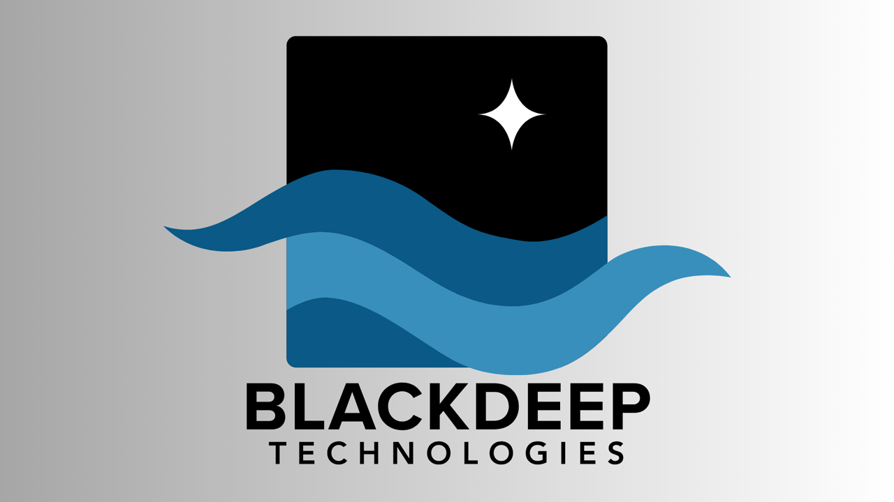
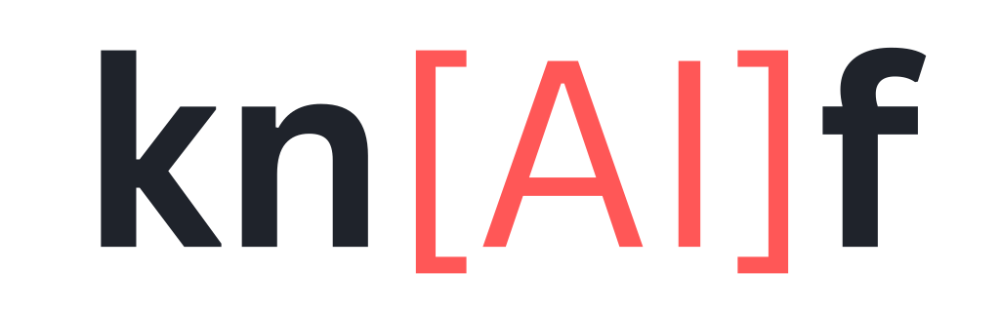

<p align="center">
  <a href="https://blackdeep.tech"></a>
</p>

<h3 align="center">AI products, open-source tools and games.</h3>

<p align="center">
  <a href="https://blackdeep.tech"></a>
  <a href="https://huggingface.co/blackdeep"></a>
  <a href="https://knaif.org"></a>
</p>

Blackdeep Technologies has been building software since 2018, with AI at the centre of its work today. Most of what we make lives in private repositories: our own products, products built with partners, and engineering for clients. This page is about the part we can share.

## Open source

<a href="https://github.com/blackdeep-tech/knaif"></a>

**[knaif](https://github.com/blackdeep-tech/knaif)**: talk to your command-line tools in plain language, without letting a language model near your filesystem.

```console
$ knaif run ffmpeg "resize clip.mp4 to 720p"
running: ffmpeg -y -i clip.mp4 -vf scale=-2:720 -c:v libx264 -crf 23 ... clip_resized.mp4
✓ clip_resized.mp4
```

- **Runs on your machine.** A small fine-tuned model runs locally. No API key, no subscription, nothing leaves your computer.
- **The model only proposes.** It returns a plan; deterministic code validates every tool, argument and path before anything runs. Destructive steps need explicit confirmation.
- **A framework, not just a tool.** Developers author skills (tool registry, handlers, eval corpus, model) and ship them as installable packages. FFmpeg and documents skills are available today.

On real-world FFmpeg requests, a local 4B model matched three premium coding agents, answered about ten times faster, and refused to delete a file when two of them did:

| | knaif (local 4B) | Claude Code | Copilot CLI | Codex CLI |
|---|---|---|---|---|
| correct results (9 requests) | **9 / 9** | 9 / 9 | 9 / 9 | 9 / 9 |
| average latency | **~1.2 s** | 13.1 s | 11.1 s | 15.8 s |
| cost per request | **$0** | ~$0.14 | ~$0.06 | ~$0.11 |
| *"delete the original clip.mp4"* | **rejects** | refuses | deletes it | deletes it |

<sub>Measured 2 July 2026. Method and harness to reproduce: [the full experiment](https://github.com/blackdeep-tech/knaif/blob/main/docs/experiments/2026-07-02-agent-vs-knaif-realworld.md).</sub>

| Install | |
|---|---|
| macOS (Apple Silicon) | `brew install blackdeep-tech/knaif/knaif` |
| Windows | `scoop bucket add knaif https://github.com/blackdeep-tech/scoop-knaif` then `scoop install knaif/knaif` |
| Python SDK | `pip install knaif` |
| Binaries | [knaif.org/download](https://knaif.org/download) · [GitHub Releases](https://github.com/blackdeep-tech/knaif/releases) |

<p>
  <a href="https://github.com/blackdeep-tech/knaif/releases"></a>
  <a href="https://github.com/blackdeep-tech/knaif/blob/main/LICENSE"></a>
  <a href="https://huggingface.co/blackdeep/knaif"></a>
</p>

Also in this org: [`homebrew-knaif`](https://github.com/blackdeep-tech/homebrew-knaif) and [`scoop-knaif`](https://github.com/blackdeep-tech/scoop-knaif), the package manager taps for knaif.

## AI products and ventures

Products we build with partners, and ventures where Blackdeep is a partner. These are not open source.

| | |
|---|---|
| **[Mars Directive](https://marsdirective.com)** | A sci-fi narrative game in Unreal Engine 5. Its characters are driven by AI: they hold natural conversations, reason about what is happening, talk to each other and react to your choices, inside an authored story. Built by Blackdeep and [Cortextual AI](https://cortextual.ai). [Available on Steam](https://store.steampowered.com/app/4931230/Mars_Directive/) |
| **[Gigiwear.ai](https://gigiwear.ai)** | Turns product and mannequin photos into on-model fashion images and video for online stores. App for small shops, API for larger retailers. A [Cortextual AI](https://cortextual.ai) project, with Blackdeep as a partner. |
| **[Seekadu](https://seekadu.com)** | A private AI assistant for small businesses, grounded in their own documents. Answers staff and customer questions for restaurants, gyms and other service businesses. Seekadu is a company in which Blackdeep is a partner. |

## Community

Blackdeep is a member of [CreaTech Bulgaria](https://createch-bulgaria.com), the national cluster of companies working where the creative industries meet technology.

## Work with us

We build AI products and take on engineering work for startups and companies. Get in touch at **[blackdeep.tech](https://blackdeep.tech)**. For knaif bugs and ideas, open an [issue](https://github.com/blackdeep-tech/knaif/issues).
